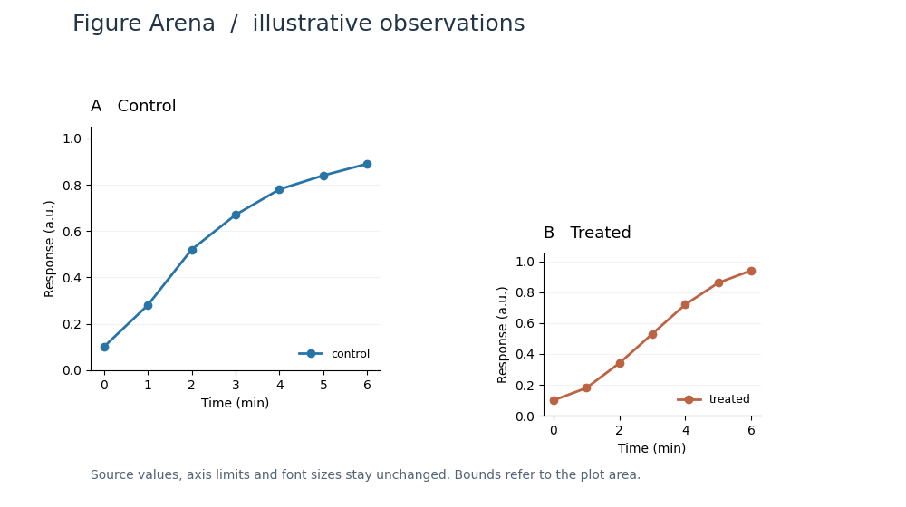
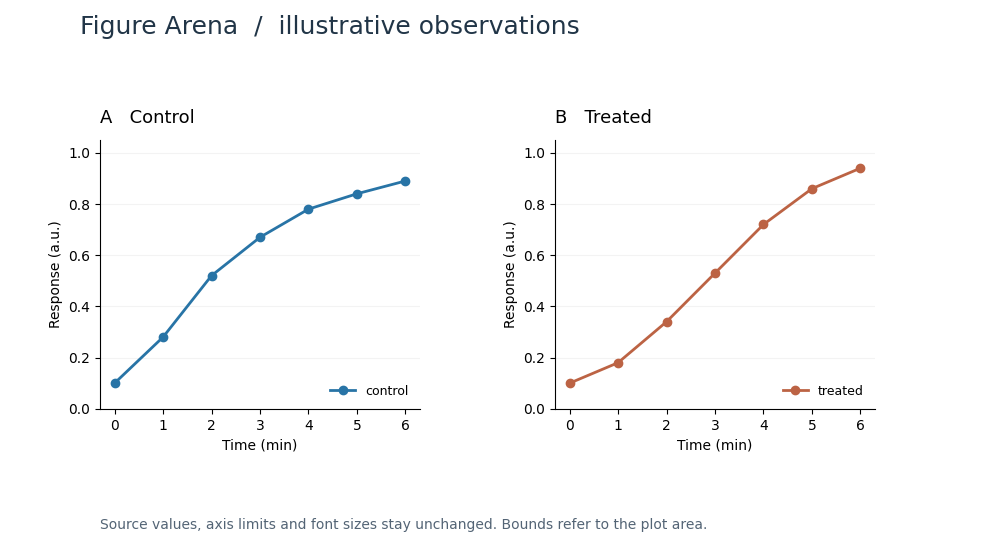
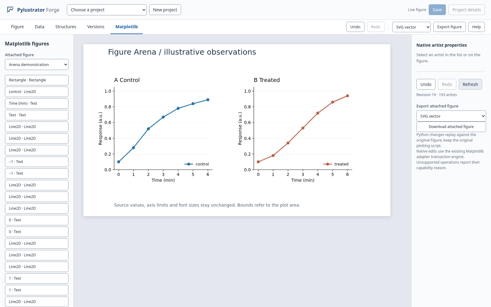

# FigReflow native Figure Arena

An opt-in **observe → act → observe** HTTP adapter for PR #16's existing
`FigureSession`. It loads a trusted, in-process Matplotlib Figure into the same
native editor, exposes stable object IDs and a real PNG preview, and executes
move, plot-area scale, align, undo and redo through the existing semantic command
engine. No model, provider, API key, Qt application or external service is needed.

The implementation is additive: `web/arena.py`, a runnable example and tests.
`web/app.py`, `web/session.py`, renderer, browser editor and content detection are
unchanged. The prerequisite is the current Draft PR [#16](https://github.com/Molaison/pylustrator-illustrator/pull/16),
branch `codex/web-research-studio`, inspected at `a54f6da`.

## Observed before and after

The loaded Figure has a smaller, lower Panel B:



After the HTTP move, scale and top alignment, both plot areas have equal size
and the same top edge. The curves, tick values, labels and legends remain:



[Undo output](assets/arena/undo.png) · [Redo output](assets/arena/redo.png) ·
[Measured results](assets/arena/checks.json) · [Requests and receipts](assets/arena/requests.json)

The same native Figure in the **existing editor**, captured with Chromium:

[Before in the editor](assets/arena/editor-before.png)



The browser verification repeats the workflow in the live demo session, so its
monotonic revision counter is higher than the first run's saved JSON.

## Run the complete example

From this checkout, with Python 3.11 or newer:

```bash
python -m pip install -e '.[web]'
python -m pylustrator.web.arena_demo --output /tmp/arena-demo
```

Open `/tmp/arena-demo/index.html`. It contains six actual renderer outputs and
object coordinates: initial figure, move, scale, align, undo, redo. The input is
the bundled illustrative `web/examples/arena_observations.csv`, loaded into two
real scientific panels. The caller goes through the HTTP routes using FastAPI's
in-process client, without starting a network listener.

The script verifies the numerical results as well as the visible result:

| Stage | Panel B x | y | width | height |
|---|---:|---:|---:|---:|
| Loaded | 600 | 280 | 240 | 179.2 |
| Move −45, −40 | 555 | 240 | 240 | 179.2 |
| Scale 4/3, 1.5 | 555 | 240 | 320 | 268.8 |
| Align top to A | 555 | 140 | 320 | 268.8 |
| Undo alignment | 555 | 240 | 320 | 268.8 |
| Redo alignment | 555 | 140 | 320 | 268.8 |

Source x/y arrays, axis limits and font sizes are checked directly. The aligned
and redone PNG bytes must match; the before and aligned images must differ.
`checks.json` contains measurements, `requests.json` contains each HTTP action
and receipt, and the per-stage JSON contains both object IDs and its PNG.
`native-changes.py` is the existing editor's replay export. Run that trusted
snippet after reconstructing the original Figure as `fig` at its original DPI
and size. The example does not overwrite its input CSV.

To keep the same edited Figure open in the existing browser editor:

```bash
python -m pylustrator.web.arena_demo --output /tmp/arena-demo --serve --port 8765
```

Open `http://127.0.0.1:8765` and select **Matplotlib**. The server remains local;
stop it with Ctrl+C. The example prints the session ID for subsequent HTTP calls.

## Attach to an existing application

```python
from pylustrator.web.app import create_app
from pylustrator.web.arena import install_arena
from pylustrator.web.session import FigureSession

session = FigureSession(fig, name="My scientific figure")
app = create_app("./workspace-data", sessions=[session])
install_arena(app)  # Call before starting the server. Repeated installation is safe.
# Serve this `app` with the existing local uvicorn setup.
# Call session.close() when its owning process is finished.
```

`install_arena` reuses the app's session registry, locks, host/origin validation,
optional token and no-store headers. It does not alter any existing endpoint or
automatically enable the API in ordinary installations. Do not create multiple
`FigureArena` instances for one session: IDs, receipts and history ownership
belong to the installed adapter. Direct Python callers can use
`FigureArena(session).observe()` and `.act(payload)` with the same contract.

## HTTP contract, version 1

Discover sessions through the existing `GET /api/sessions`. Set `BASE` to
`/api/arena/sessions/{sessionId}`.

| Method and path | Result |
|---|---|
| `GET BASE/observe` | One coherent observation: revision, canvas, objects, history and base64 PNG |
| `POST BASE/actions` | `{receipt, replayed, observation}` after an action |
| `GET BASE/requests/{requestId}` | Original action receipt, useful after a lost response |

An observation contains:

```json
{
  "protocolVersion": 1,
  "sessionId": "session-…",
  "revision": 0,
  "canvas": {"width": 1000, "height": 560, "dpi": 100, "origin": "top-left", "units": "pixels"},
  "objects": [{
    "id": "object-…", "nativeId": "artist-…", "name": "Panel A · control",
    "type": "Axes", "bounds": [100, 140, 320, 268.8], "basis": "plot_area",
    "visible": true, "locked": false,
    "capabilities": {"move": true, "scale": true, "align": true}, "restriction": ""
  }],
  "history": {"canUndo": false, "canRedo": false, "scope": "Arena actions since the latest external session edit"},
  "preview": {"mimeType": "image/png", "encoding": "base64", "width": 1000, "height": 560, "data": "…"}
}
```

Decode `preview.data` directly, or use `data:image/png;base64,` plus that value.
Its geometry and PNG are captured under the **same session/render locks**. There
is no separate stale image URL. The preview uses the full canvas even when the
caller configured Matplotlib's default exports to crop tightly. Previews are
bounded to 8 megapixels and 8192 pixels per side.

Object IDs survive move, scale, align, undo and redo. They refer to live Artist
identity, not labels or list positions, and never transfer to replacement
objects. They are scoped to this adapter/session lifetime. `nativeId` links an
object to the existing native editor's artist inventory; actions require the
Arena `id`. Scientific lines/points and axes-owned labels are not independently
editable Arena targets. Their rendered content remains visible in the preview.

Every action requires a fresh `requestId` and the observed integer `revision`:

```json
{"requestId":"move-1","revision":0,"operation":"move","target":"object-B","dx":-45,"dy":-40}
```

```json
{"requestId":"scale-1","revision":1,"operation":"scale","target":"object-B","factorX":1.3333333333333333,"factorY":1.5,"basis":"plot_area","anchor":"top-left"}
```

```json
{"requestId":"align-1","revision":2,"operation":"align","target":"object-B","reference":"object-A","edge":"top","basis":"plot_area"}
```

```json
{"requestId":"undo-1","revision":3,"operation":"undo"}
```

```json
{"requestId":"redo-1","revision":4,"operation":"redo"}
```

Unknown or missing fields are rejected. A request ID is a nonempty identifier
of at most 128 characters using letters, digits, `.`, `_`, `:`, `-`. Use UUIDs
for callers that may reconnect. Each action targets **one** object and produces
at most one native history entry. No-op actions retain the revision and redo.

* **Move:** `dx`/`dy` are finite pixel offsets, positive right/down.
* **Scale:** positive `factorX`/`factorY` in `[0.01, 100]`; `anchor` is
  `top-left` (default) or `center`. `basis` must be `plot_area`. This resizes an
  Axes' plot rectangle, preserving data values, limits and font sizes. It is not
  whole-panel appearance scaling. Figure text cannot be scaled through this API.
* **Align:** `edge` is `left`, `center`, `right`, `top`, `middle` or `bottom`.
  `reference` is another visible object with the same basis, or `artboard`.
  `basis` must match the observation (`plot_area` or figure `text`). The adapter
  calculates one translation, then invokes the existing semantic move command.
* Resulting target bounds must fit the artboard and be at least one pixel in
  each dimension. This checks the reported bounds, not the full label/legend
  envelope. Review the PNG to judge spacing and label clipping.

Supported panels are independent Cartesian Axes with automatic aspect and no
axes locator. Automatic figure layout, twinned axes, fixed-aspect/3D/polar
panels and text in non-figure coordinates report restrictions rather than
claiming an exact edit. Hidden and locked targets cannot be changed. Existing
semantic adapter preflight remains authoritative.

## Conflicts, retries and history

Actions use the **same monotonic revision as the native editor**. An edit from
the browser invalidates an earlier Agent revision. A mismatch returns HTTP 409
`revision_conflict`; get another observation before planning a new action.
Removed, unknown or cross-session IDs return 409 `stale_object`.

Retry a request with its **identical original payload**, including revision and
request ID. It returns `replayed: true`, the original receipt, and a new
observation of the current Figure. It does not reapply an old action, even after
undo or intervening edits. A reused ID with a different payload returns 409
`request_conflict`. `receipt.appliedRevision` and `observation.revision` may thus
differ. Failed validation does not reserve a request ID.

Receipts are recorded before result rendering. If an action committed but its
response preview failed, HTTP 503 `result_unavailable` includes its receipt.
Read `GET BASE/requests/{requestId}` or retry identically. Do not issue a new ID
merely because a response was lost. The 1000-action session budget fails closed
instead of evicting receipts and accidentally applying an old request twice.

Undo and redo invoke **FigureSession's existing history**, with only ownership
markers in Arena. An intervening native command resets Arena's available undo
scope; attempting to cross that boundary returns 409 `history_boundary`. Native
editor history is retained. This avoids undoing a user's unrelated text or data
edit. The native engine retains its existing 200-entry undo limit.

Validation errors are HTTP 400; unknown sessions/receipts are 404. Errors use
`{"error":{"code":"…","message":"…"}}`, with a `receipt` inside the error
when a committed result is temporarily unavailable. Existing authentication and
origin failures remain 401/403. Never mutate the attached Figure concurrently
from arbitrary Python: the underlying FigureSession cannot revision-track those
changes. Removing/replacing a target is still detected by the next action.

## Scope and integration boundaries

This minimal adapter covers the editor's **live native Figure contract**.
Composition JSON projects, durable project checkpoints and provider-driven
planning are not new features of this module. The native session, IDs and
receipts end when its process ends. Existing replay export provides a reproducible
handoff; existing composition project versions retain their separate semantics.

There is no segmentation, cropping, imported-image reconstruction, content-box
estimation or plotting-region detector here. Axes bounds are obtained from the
existing semantic adapter. `basis` is an explicit future integration point for
the parallel content-boundary work: additional bounds providers need a defined
coordinate/provenance contract and tests before additional basis values are
accepted. No content-detection files are imported or changed.

The thin bridge uses public `FigureSession.describe`, `artist_id`, `command`,
`render`, `revision` and `lock`. Its one Matplotlib internal inspection is
`Axes._twinned_axes.get_siblings`, used solely to reject coupled axes. It does not
write private session state or introduce a second geometry/history engine.

## Targeted verification

```bash
python -m pip install -e '.[web,test]'
MPLBACKEND=Agg python -m pytest -q tests/test_web_arena.py tests/test_web_session.py tests/test_web_api.py
python -m pylustrator.web.arena_demo --output /tmp/arena-demo
```

With the illustrative `--serve` demo still running, the optional real-browser
check uses Playwright and captures the existing editor before/after/undo/redo:

```bash
python scripts/test_arena_browser.py --output /tmp/arena-browser
# Or use an already-installed browser: --chromium /usr/bin/chromium
```

It accepts only the session named `Arena demonstration`, restores the demo's
three initial actions, and applies the same workflow over loopback HTTP. It
checks native-editor geometry against Arena readback and records page errors.

The checks cover actual panel movement and scaling, rendered before/after pixels,
replay into a fresh Figure, data/font/limit preservation, stable and removed IDs,
strict geometry, duplicate and concurrent requests, native-editor conflicts,
undo boundaries, post-commit render failures, and shared HTTP authorization.
There is no live paid model call and no claim of image-understanding evaluation.

Recorded in the cloud workspace on 2026-10-29: the targeted Arena/native/API
suite passed; Chromium displayed the same geometry before/after/undo/redo with
no page errors; Ruff and scoped Ty checks passed. Python was 3.12.14. The local
FastAPI test client emitted its existing Starlette/httpx deprecation warning.
The full desktop suite and every Python/dependency matrix were not run locally.
