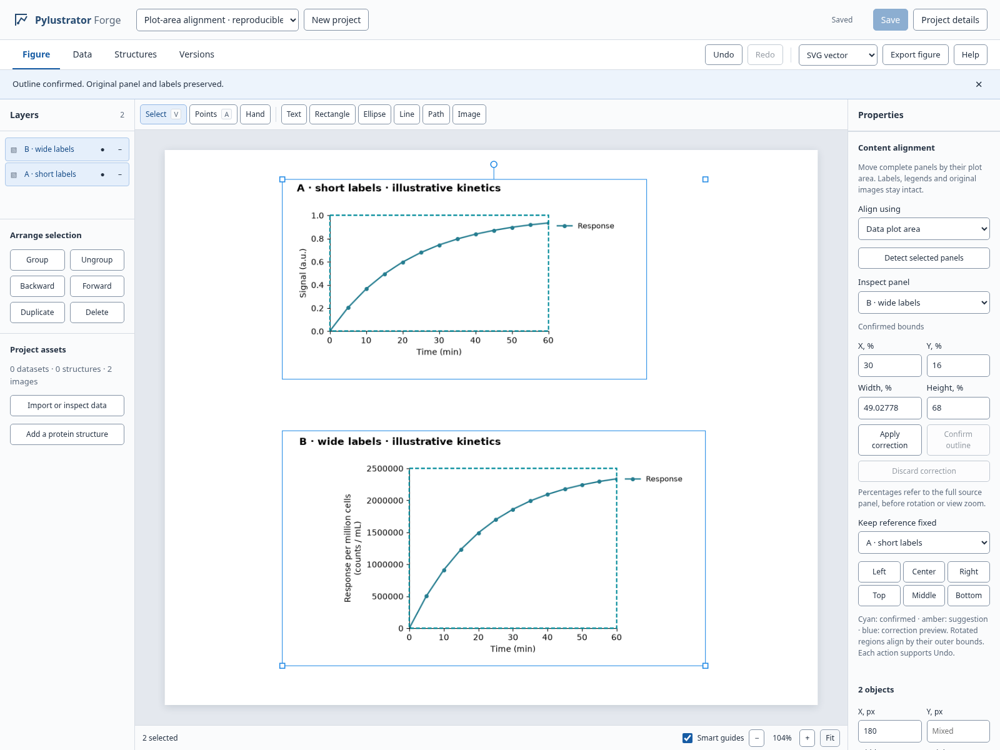
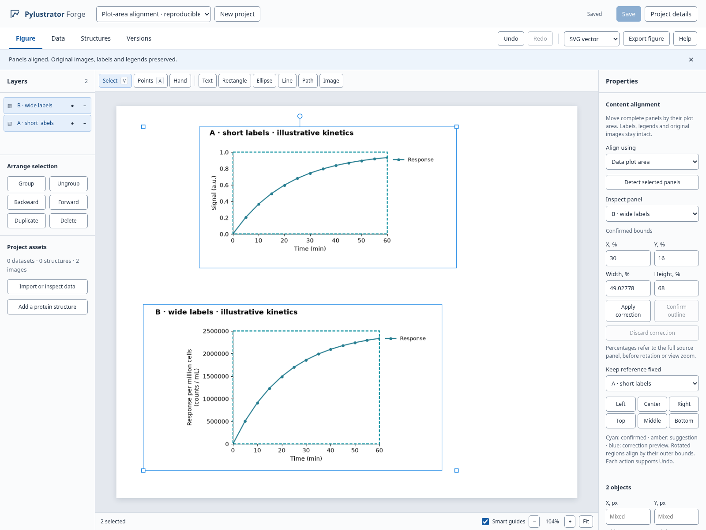

# Align actual plot areas without losing labels

This addition to the PR #16 Web composition editor distinguishes the original
panel, all visible content, and the data plot area. The Content alignment section
moves complete panels relative to a selected reference. It never crops or
resamples source assets, changes datasets, or resizes scientific axes.

The implementation is based on `codex/web-research-studio` at `a54f6da`.
The existing layer, pointer gesture and undo/redo implementations are unchanged.
Agent observation/command APIs and the separate live native-session UI are outside
this change. Matplotlib **composition plots** use exact renderer-owned Axes;
`matplotlib_regions(figure)` also exposes the same measurement for trusted callers.

## Ordinary project workflow and recovery

No demo setup is needed: start `pylustrator-web`, create a blank project and use
the **Image** button to import a PNG, or add a data plot from **Data**. Selecting
that panel opens **Content alignment** in Properties. The built-in Help dialog
also describes this entry point.

- A changed numeric field is an **unapplied preview**. Confirmation, detection
  and alignment pause until **Apply correction** or **Discard correction**;
  Escape in the form also discards the draft. Confirming a different, previously
  detected outline while a draft is visible is prevented.
- **Cancel detection** aborts the browser request and leaves the prior metadata
  and history intact. Changing the project, selection or document also cancels
  stale work. The server may finish an already-running read-only computation;
  cancelled results are never committed to the document.
- Detector errors name the affected panel and offer retry or manual bounds.
  No partially completed batch replaces selected bounds. Unsupported selections
  explain that only visible, unlocked images and plots can be edited.
- After source replacement or plot layout changes, **Source changed** explains
  how to re-detect or enter new bounds. Old overlays disappear. Manual corrections
  persist through ordinary Save/reload and the existing Undo/Redo workflow.
- Percentages always refer to the complete source panel before its rotation or
  viewport zoom. A rotated region's outer bounds determine its alignment edge.

[Ordinary PNG import and source replacement in the editor](assets/content-regions/ordinary-import-workflow.png)

## Try the interactive editor

```bash
python -m pip install -e '.[web,browser-test,test]'
python scripts/demo_content_regions.py --output /tmp/figreflow-demo --serve
```

Open `http://127.0.0.1:8766`. Choose **Plot-area alignment · reproducible demo**.

1. Select both image layers using Shift-click.
2. In **Content alignment**, choose **Data plot area**, then **Detect selected panels**.
3. Use **Inspect panel** to review each amber outline and **Confirm outline**.
4. Keep A as the reference and press **Left** in Content alignment. Both plot axes
   align while the wider labels and the legends remain visible.
5. Edit X/Y/Width/Height percentages to preview a correction. **Apply correction**
   commits it. Undo/Redo restores both region edits and alignment independently.
6. Save, reload, and export the project. Region metadata survives project saves,
   bundles and checkpoints; exported artwork contains the complete original panels.

The two PNGs are actual Matplotlib products from
[`demo_content_regions.py`](../scripts/demo_content_regions.py), not mock images.
The script records input rows and exact Axes geometry in
[`source-manifest.json`](assets/content-regions/source-manifest.json).
Values are explicitly illustrative kinetics, not experimental measurements.
Original products: [panel A](assets/content-regions/panel-a.png) and
[panel B](assets/content-regions/panel-b.png).

## Observed result

All distances below use document (artboard) pixel coordinates, computed as
`element.x + element.width × source Axes fraction`, before viewport zoom. The
screenshots show a 104% viewport zoom; the report uses unscaled document geometry.

Before: the source image frames share an X coordinate, but the actual data axes
are **121.86 document px apart** because the white margins and tick labels differ.



After: the detected axes align exactly. Compared with the original Matplotlib
geometry, the residual difference is **0.36 document px**, below one document pixel; this is
the expected raster sampling difference. Source bytes, labels and legends are
preserved. Native composition plots do not incur this raster estimation error.



[Manual correction preview](assets/content-regions/manual-preview.png) ·
[390 px drawer](assets/content-regions/narrow.png) ·
[Machine-readable result](assets/content-regions/verification.json)

## Detection and failure boundaries

- **Matplotlib:** draw under the existing render lock, read Axes window bounds and
  decorated tight bounds. The composition renderer's layout helper is reused;
  there is no second copy of its margin formulas. Source labels already outside
  the panel produce an explicit warning; this feature cannot restore clipped input.
- **PNG:** downsample to at most 1400 × 1400 for bounded CPU processing. Estimate a
  uniform border/background (including alpha), then find foreground content and
  a long neutral-dark left/bottom spine junction. All raster results require
  review and confirmation. Confidence values are heuristic scores, not calibrated
  probabilities. No learned model, GPU, external provider or paid call is used.
- **Ambiguous images:** multiple detected axes, blank images, nonuniform borders,
  borderless plots or missing/pale/rotated spines produce missing bounds and an
  explanation. Small insets, bars, heavy grids, decorative frames or photos can
  fool the heuristic; never assume it understands scientific semantics. Set the
  intended bounds manually when the overlay is wrong.
- **Safe translation:** all selected items must be visible, unlocked image/plot
  panels. Grouped panels must be ungrouped first. Alignment preflights the whole
  selection and rejects any move that would put a complete panel outside the
  artboard; it does not partially move the selection. Rotated regions align using
  their transformed axis-aligned outer bounds.
- **Staleness:** source replacement or plot specification/size changes invalidate
  measurements. Raster regions scale with their complete images. Changes during
  an outstanding detection discard its results. Manually correcting stale metadata
  starts a new source snapshot rather than blessing other obsolete regions.

## Integration contract

`content_regions.py` owns validation and measurement. `content_region_routes.py`
installs a read-only project-scoped query:

```text
POST /api/projects/{project_id}/content-regions/detect
{ "element": <current image or plot element, including unsaved geometry> }
→ { "elementId": "...", "regions": <ContentRegionsV1> }
```

Detection does not save a document or advance a project revision. Asset/dataset
resolution remains scoped to the named project. The optional `contentRegions`
field is validated and retained by the existing document/store/export pipeline.

```json
{
  "version": 1,
  "coordinateSpace": "normalized-panel",
  "source": { "type": "image", "assetId": "immutable-project-asset" },
  "plot": {
    "bounds": { "x": 0.13, "y": 0.18, "width": 0.60, "height": 0.58 },
    "method": "raster-spines",
    "confidence": 0.8,
    "confirmed": false
  },
  "content": null,
  "warnings": ["Review the detected outline before alignment."]
}
```

Bounds are top-left fractions of the **entire original panel**, with positive
width/height contained in `[0, 1]`. `plot` and `content` may each be null; the panel
rectangle is implicitly `(0, 0, 1, 1)`. Plot sources contain the normalized plot
specification and render width/height instead of an asset ID. Allowed methods are
`matplotlib`, `raster-spines`, `background`, and `manual`.

`content-region-geometry.js` exports `sourceFor`, `regionsCurrent`, `regionBounds`,
`regionCorners`, `worldBounds`, `manualRegion`, `confirmRegion`, and `alignRegions`.
Its mutating helpers reuse `EditorState.mutate`; no history or pointer core is
reimplemented. The UI subscribes to the existing state and adds a noninteractive
overlay. Future Arena integration can consume this contract without editing these
modules. An older application version ignores this optional metadata on load/save;
keep an exported bundle before rolling back if region annotations must survive.

## Local compatibility with the native Arena branch

The content branch and `codex/figreflow-agent-arena` at `cbf2730` were combined
in an isolated local worktree, with no file conflicts. No Arena files or its
remote branch were modified, and no remote merge was performed.

The combined contract check verifies actual project detection/save alongside
Arena observe/move/undo in one app. The native Axes plot bounds match
`matplotlib_regions(figure)` after multiplying normalized coordinates by the
Arena Figure's own width/height. Native session actions leave the saved project,
its region metadata and its immutable PNG bytes unchanged; project detection
does not advance the native session revision.

These are **two distinct object domains**. Arena IDs belong to live native
Figures, while content panel IDs belong to persisted project documents. Passing
a project panel ID to the native Arena rejects rather than editing another
object. Agent actions on imported project PNGs would need a project-document
command adapter; this change does not imply that native Arena already supports
them. The existing project-scoped detection response is available for that later
integration without reimplementing detection or browser history.

Run the optional combined check only in a checkout containing both branches:

```bash
python -m pytest -q tests/test_web_content_arena_integration.py
```

It skips explicitly in the standalone content branch when Arena is absent.

The combined wheel was also installed in a fresh virtual environment through
normal dependency resolution with `[web,browser-test]`. From outside the checkout,
the installed app served the region UI/CSS and real detection route, and opt-in
Arena observation loaded its packaged CSV. The complete browser workflow then ran
against that installed app, using Matplotlib 3.11.2 and FastAPI 0.162.0, without Qt.
See [installation record](assets/content-regions/installed-package.json) and
[installed-app browser record](assets/content-regions/verification.json).

## Reproduce validation

```bash
python -m pytest -q tests/test_web_*.py
node --test tests/web/*.test.mjs
ruff check .
ty check pylustrator/web/content_regions.py pylustrator/web/content_region_routes.py \
  pylustrator/web/document.py pylustrator/web/app.py \
  scripts/demo_content_regions.py scripts/test_content_regions_browser.py
python scripts/test_content_regions_browser.py --output /tmp/content-region-evidence
```

Install Playwright Chromium if needed, or set `CHROMIUM_PATH` to an already
installed Chromium. The browser script starts a separate local server and creates
its own demo workspace. It emits genuine screenshots, an aligned PNG export,
original assets, before/after project bundles, and a JSON verification record.
The browser flow first creates an ordinary blank project, imports PNGs via the
existing file picker, saves/reloads manual bounds, and replaces an image through
the real versioned project API to verify invalidation and recovery. Normal
detection, rendering and persistence use the real backend. A held request and
an HTTP 503 are explicitly simulated to exercise cancellation and error recovery.
No benchmark or performance improvement is claimed.

To run the same browser flow against a wheel installed outside the checkout,
use its Python environment and pass the installation's site-packages directory:

```bash
python scripts/test_content_regions_browser.py --output /tmp/wheel-evidence \
  --installed-package /path/to/venv/lib/python3.12/site-packages
```

The initial checkout checks used Python 3.12, Matplotlib 3.10.8 and FastAPI 0.141.1.
The current screenshots and browser record come from the installed combined wheel
with Python 3.12.14, Matplotlib 3.11.2, FastAPI 0.162.0 and Chromium 154.0.8037.57.
All 105 Web tests and 13 state/geometry tests passed; the optional Arena integration
test skips on the standalone content branch and passes in the combined worktree. Browser
checks cover real detection, confirmation, alignment, correction, Undo/Redo,
unchanged PNG source bytes, save/reload, delayed response rejection, native plot
measurement, resized plot invalidation and a 390 px drawer. No page errors.
Ruff 0.14.11 and the targeted Ty 0.0.44 check pass. Full-repository Ty in the original
test environment remains limited by missing desktop/scikit-image imports; desktop
interaction and full locked CI are unverified here. The separate clean wheel
installation resolved all declared headless dependencies successfully.

Review used the evidence-review workflow on the code, independent Axes truth and
real browser outputs. The author performed this review; no independent subagent
review or PR approval is claimed. Model/reasoning/fast settings were not exposed
by the cloud runtime, so those requested execution settings could not be verified.
